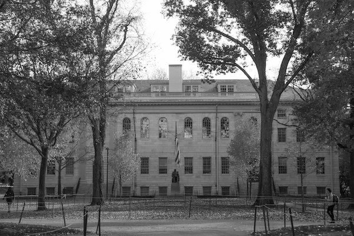
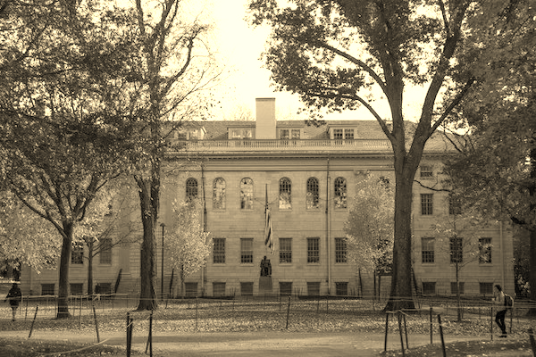
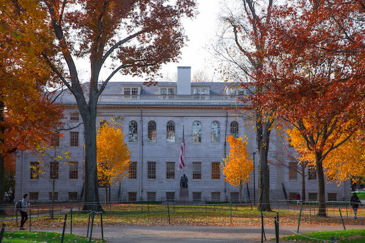

# CS50 Filter (less comfortable)

Four image filters written in C for 24-bit BMP files: greyscale, sepia, reflect and blur. I wrote the four functions in `helpers.c`.

## Usage

```
make filter
./filter -g input.bmp output.bmp   # greyscale
./filter -s input.bmp output.bmp   # sepia
./filter -r input.bmp output.bmp   # reflect
./filter -b input.bmp output.bmp   # blur
```

## Before and after

| Original | Greyscale |
|---|---|
|  |  |

| Sepia | Reflect |
|---|---|
|  |  |

| Blur |
|---|
|  |

## What I learned

- Averages of integers must be made decimal and rounded with `round()`.
- Blur must read from a copy of the image, or already-blurred pixels get averaged again and the image smears.
- Working with two-dimensional arrays: `image[row][column]`.
